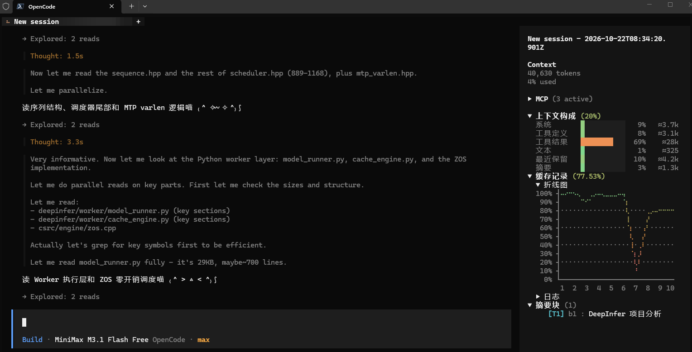

# compressed-context

[](https://github.com/1cyberlangke1/compressed-context/actions/workflows/ci.yml)
[](https://www.npmjs.com/package/compressed-context)
[](LICENSE)

OpenCode 的上下文压缩插件。它会将较早的对话历史折叠成独立的摘要块，让长会话在有限的上下文窗口里继续跑下去。



## 架构与工作原理

插件接管发给模型的上下文：把较早的对话折叠成摘要块，让长会话继续跑下去：

```text
原始上下文:
[ 系统提示词 ][ 早期历史对话 ............................. ][ 最近活跃对话 ]
                                      ↓ 触发压缩 (T1)
一级压缩后:
[ 系统提示词 ][ T1 摘要块 #1 ][ T1 摘要块 #2 ] ............ [ 最近活跃对话 ]
                                      ↓ 摘要堆积达到阈值 (T2/T3)
分层合并后:
[ 系统提示词 ][ T2 合并摘要 (块#1+#2) ][ T1 摘要块 #3 ] .... [ 最近活跃对话 ]
```

- **递归分层折叠**：
  - **T1 级**：将溢出的原始对话流折叠为自包含检查点（原始消息移入持久化存储，释放窗口）。
  - **T2 / T3 级**：当摘要块自身占用接近预算上限时，自动在后台挑**占用最大的那一层**，由模型决定一次合并前 1..N 个同层块。层级封顶 T3，顶层因此是“滚动累积块”。
- **保留区**：最新 `recentT1Blocks` 个 T1 块不参与合并，越老的记忆越模糊；预算压不下去时保留区会逐级让位。
- **树高**：每个块记录树高 `height`（T1=1，合并块 = 1 + 子块最大高度），提示词块头显示成 `[T3] {h6}`，侧栏同一个数字并作为渐变色依据喵
- **无损按需回溯**：模型可在需要时通过 `decompress` 按块还原历史，支持只解压下一层级摘要或直接恢复原始对话流。

## 核心特性

- **自动压缩**：上下文达到阈值时自动触发（工具调用循环中的子步骤同样生效）。
- **主动压缩**：向模型暴露 `compress` 工具，允许模型在阶段性任务完成后主动打检查点。
- **多级合并**：T1 负责压缩原始对话；当摘要本身积攒过多时，会自动向上合并为 T2、T3 高阶摘要。
- **按需解压**：模型可通过 `decompress` 工具还原指定摘要块（支持逐层展开或直接恢复为原始对话）。
- **缓存友好**：压缩请求尽量保持前缀不变，避免破坏 Prompt Cache。
- **双摘要格式**：支持标准 `markdown`（默认）和极致压缩的 `babel` 格式（首行 `T=标题|G=目标`，正文为高密度非自然语言）。
- **超长提醒**：上下文增长超过设定阈值时，在请求尾部追加轻量提醒，引导模型自主决定压缩时机；`compress` 工具关闭时自动跳过。
- **TUI 面板**：直观查看摘要块、缓存命中率与上下文构成，支持在面板内直接修改配置。
- **版本更新**：设置菜单直接显示当前版本并检查 npm 最新版；发现新版后加星标与警示色，确认后在 TUI 内原地显示更新进度，完成后提示重启 OpenCode，不弹出独立 shell 窗口。
- **按模型设置**：可为单个模型（或所有同名模型）覆盖阈值类参数；侧栏常驻显示当前模型实际生效的设置与来源。

## 安装与配置

插件通过 npm 分发，OpenCode 启动时会自动安装。

由于本插件会接管上下文管理，**建议同时关闭 OpenCode 原生的自动压缩**，避免两套策略打架。在全局配置 `~/.config/opencode/opencode.json`（或项目级 `opencode.json`）中加入：

```json
{
  "plugins": ["compressed-context"],
  "compaction": { "auto": false }
}
```

插件首次启动时会检测 `compaction.auto`；如果它仍然是开启状态，会弹窗询问是否关闭。选择关闭后会直接修改对应的 JSON/JSONC 配置文件（不做备份），拒绝则不会写入。

**本地开发调试**：如果你拉取了源码自行修改，直接填入本地仓库的绝对路径即可：

```json
{
  "plugins": ["/absolute/path/to/compressed-context"],
  "compaction": { "auto": false }
}
```

## 配置项

所有配置均可直接在 TUI 的插件设置面板中修改，或通过配置文件写入：

| 配置项                 | 默认值             | 说明                                                           |
| ---------------------- | ------------------ | -------------------------------------------------------------- |
| `contextLimit`         | `"auto"`           | 上下文窗口上限。填具体数字时，实际取该值与模型原生窗口的较小值 |
| `triggerPercent`       | `80`               | 上下文占用达到百分之多少时触发自动压缩                         |
| `autoCompress`         | `true`             | 是否开启自动压缩                                               |
| `summaryBlockPercent`  | `10` | 单个摘要块的 Token 预算（占窗口的百分比）                      |
| `summaryTotalPercent`  | `50` | 所有摘要的总 Token 预算占比，超出后触发合并（最高 T3）           |
| `recentT1Blocks`       | `2`  | 保留区：最新这么多个 T1 块不参与合并；`0` 关闭                  |
| `summaryFormat`        | `"markdown"`       | 摘要格式：`markdown` 或 `babel`                                |
| `summaryLanguage`      | `"auto"`           | 摘要语言（`babel` 格式下忽略此项）                             |
| `nudgeGrowthTokens`    | `50000`            | 触发“主动压缩提醒”的 Token 增长阈值，设为 `0` 则关闭；`compress` 工具关闭时跳过 |
| `enableCompressTool`   | `true`             | 是否允许模型调用 `compress` 工具                               |
| `enableDecompressTool` | `true`             | 是否允许模型调用 `decompress` 工具                             |
| `decompressTempMaxAgeHours` | `24`          | 启动时清理超过这个小时数的解压临时文件（1–720）               |

关闭 `compress` 工具后，主动提醒会直接跳过，但不会改写你的 `nudgeGrowthTokens` 设置；重新打开工具后提醒会按原设置恢复。

## 按模型设置

同一份配置可以给不同模型单独设阈值。默认值永远按**该模型自己的窗口**折算，所以不配置任何东西时，200K 模型和 1M 模型本来就会得到不同的触发点。

```jsonc
{
  // 全局默认：没单独设置的模型都用这套
  "triggerPercent": 90,
  "summaryTotalPercent": 50,

  "models": {
    // 只写模型名：所有提供商的同名模型都生效
    "claude-sonnet-4-5": { "triggerPercent": 80 },

    // 提供商/模型：最具体，优先级最高
    "google/gemini-3-pro": { "contextLimit": 800000, "summaryTotalPercent": 40 }
  }
}
```

合并顺序：**内置默认 → 全局字段 → `models["模型名"]` → `models["提供商/模型"]`**。

只有这 6 个 token 相关字段可以按模型覆盖：`contextLimit`、`triggerPercent`、`nudgeGrowthTokens`、`summaryBlockPercent`、`summaryTotalPercent`、`recentT1Blocks`。

配置里只保存**真正改过的字段**：某个字段改回与全局相同的值时会自动删除，一条覆盖里的字段全被删掉时整条移除，`models` 为空时连这个键也不留。

TUI 里同样能改：`/compressed-context` 打开设置后，第一层是 `默认设置 / 按模型 / 摘要 / 开关 / 解压 / 界面 / 检查更新`：

- `默认设置` 只放 token 数值（上下文上限、压缩阈值、提醒间隔、单条/全部摘要上限）
- `按模型` → `当前模型` 直接编辑当前会话所用模型，`模型覆盖` 里管理其它模型
- 选择器里每个模型都有两行：`[提供商]模型`（精确）和 `仅模型名`（所有同名模型）；选中「仅模型名」且存在多个提供商时会再问一次作用范围
- `检查更新` 的标题直接显示当前版本；发现新版后追加 `*` 并标记右侧版本与警示色，确认后只显示 TUI 更新进度，完成后提示重启 OpenCode

## 本地开发

```bash
pnpm install
pnpm check                     # 运行 typecheck + lint + 单测 + TUI 测试
bun scripts/e2e-nudge.mjs      # E2E 测试：主动提醒（隔离环境 + Mock Provider）
bun scripts/e2e-tool-loop.mjs  # E2E 测试：工具循环内的自动压缩
bun scripts/e2e-update.mjs     # E2E 测试：真实 TUI 更新入口（本地 registry + 假更新命令）
```

发版在 GitHub Actions 手动运行 `publish` workflow，并选择 `patch`、`minor` 或 `major`；workflow 会同步版本文件、跑完整检查、提交、更新远端 `main`、打 tag 并发布 npm。`dev` 只保留在本地，不推送到远端。

## 效果参考

在 Terminal-Bench 的 `schemelike-metacircular-eval` 任务上做过初步实测：在 100k 窗口限制下，插件成功将单步上下文峰值压在 93,560 tokens 并顺利通过验证。由于单次测试存在随机波动，数据仅供参考，详细记录见 [docs/benchmark.md](docs/benchmark.md)。

## 致谢与灵感

- [billion-context](https://github.com/ranxianglei/billion-context)
- [Large Language Models Do Not Always Need Readable Language](https://arxiv.org/abs/2606.19857) —— Babel 摘要格式（BabelTele）的灵感来源

## 协议

[MIT](LICENSE) © 1cyberlangke1
