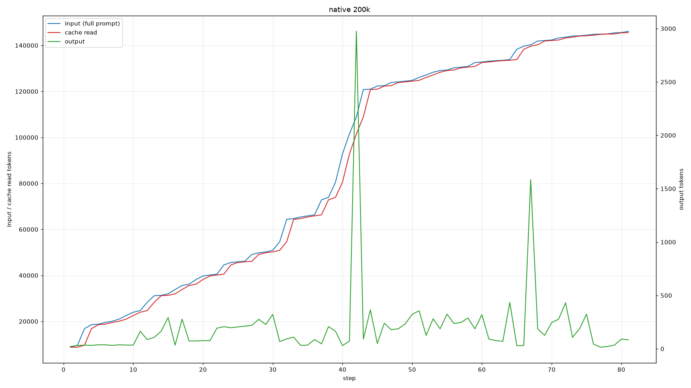
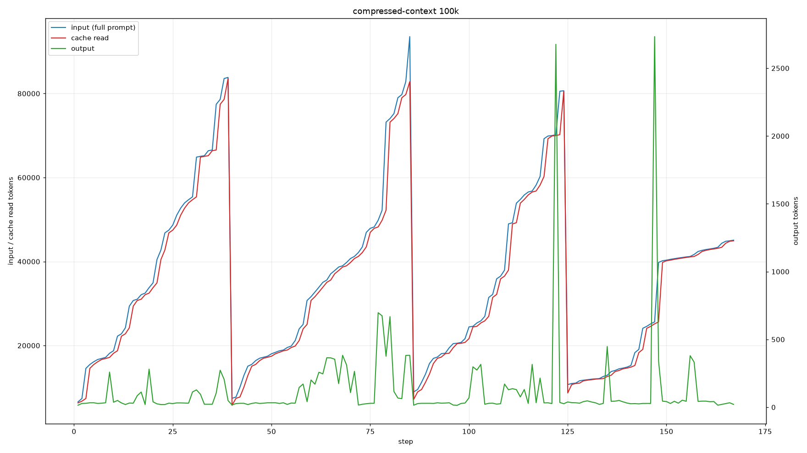
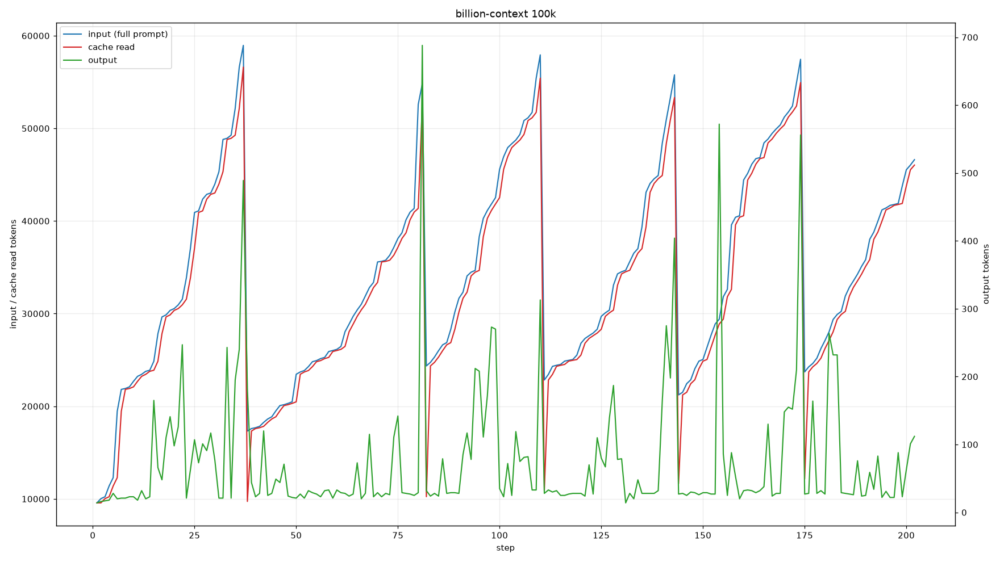

# 实测记录

> **说明**：以下为单次探索性测试（$n = 1$）的真实轨迹记录。由于 Agent 任务受模型采样随机性、网络波动及容器启动耗时影响较大，本文数据主要用于**验证插件对上下文峰值的控制效果及工作流机制**，不作为跨插件的严格性能排名。

## 测试环境

| 配置项   | 详情                                                                                  |
| -------- | ------------------------------------------------------------------------------------- |
| 测试任务 | Terminal-Bench 2.1 · `schemelike-metacircular-eval`                                   |
| 任务目标 | 用 Scheme 编写一个能同时解释自身和 `interp.py` 语言的元循环求值器（共 63 个测试用例） |
| 模型     | `gemini-3.8-flash-high`（reasoning = high）                                           |
| 超时限制 | 2400 秒                                                                               |
| 运行环境 | Harbor + Docker                                                                       |
| 样本量   | 每组 1 次                                                                             |

## 结果汇总

数据提取自 Agent 运行轨迹中每个 `step_finish` 节点的 `tokens` 统计：
- **总输入** = $\Sigma(\text{input} + \text{cache.read})$
- **缓存命中** = $\Sigma \text{cache.read}$（单步峰值计算口径相同）

| 对照组         | 窗口上限 | 使用插件           | 得分 (Reward) |           耗时 |    总输入 |  缓存命中 | 缓存占比 | 总输出 |   单步峰值 |
| -------------- | -------: | ------------------ | ------------: | -------------: | --------: | --------: | -------: | -----: | ---------: |
| **native**     |     200k | 无                 |       **1.0** |         35m18s | 7,136,447 | 6,999,101 |    98.1% | 16,441 |    146,123 |
| **compressed** |     100k | compressed-context |       **1.0** | 41m04s（超时） | 5,935,881 | 5,660,871 |    95.4% | 21,325 | **93,560** |
| **billion**    |     100k | billion-context    |           0.0 | 40m07s（超时） | 6,874,707 | 6,607,407 |    96.1% | 15,520 |     58,955 |

### 细节复盘

- **关于超时与得分**：`native` 在 35m18s 正常完结。`compressed` 虽然在 2400 秒触发了超时强杀，但在超时前已成功写出完整的 `eval.scm`，因此后续 Verifier 正常执行并判定通过（1.0）。
- **水位控制**：`native` 在 200k 窗口下峰值达到 146,123；而在 100k 窗口限制下，`compressed` 共触发了 3 次压缩（`blocks = [T1, T1, T1]`），将单步峰值死死按在了 **93,560**，未突破 100k 红线。
- **过度压缩的副作用**：`billion` 的单步峰值压得最低（58,955），但在 40 分钟内反复执行了 79 次 `python3` 命令去探测 `interp.py` 的语义，疑似因上下文丢失过多细节而陷入循环，最终未产出 `/app/eval.scm`（得 0 分）。

## 单步上下文变化曲线

### native (200k)

### compressed (100k)

> 可以清晰看到缓存命中量随对话一路爬升，触及阈值后触发压缩并垂直回落。全程共出现 3 次断崖，正好对应生成的 3 个 `T1` 摘要块。

### billion (100k)

## 测试局限性

1. **样本量极小 ($n = 1$)**：`compressed` 和 `billion` 均贴着 2400 秒的超时红线运行，成败仅在几分钟的余量之间，重跑完全可能出现结果翻转。
2. **任务难度处于模型能力边缘**：三组耗时均接近上限，说明该任务对当前模型而言本身就极具挑战。测试结果很大程度上受限于「模型能否刚好写完代码」，而非单纯取决于「压缩质量」。
3. **外部环境干扰**：测试末期的 Verifier 需要联网安装依赖，网络抖动会直接导致判 0 分，这与插件本身的表现无关。
4. **缓存统计口径**：不同模型提供商对缓存 Token 的计算与计费逻辑存在差异，此处的缓存数据不宜跨 Provider 横向对比。

## 小结

在将上下文窗口砍半至 100k 的严苛条件下，`compressed-context` 成功通过 3 次折叠将单步上下文控制在安全水位内（峰值 93.5k），并在保留关键任务状态的前提下跑通了全部测试用例。至于不同压缩策略在成功率和信息保留度上的量化优劣，仍需未来通过多轮重复测试取中位数来进一步评估。

## 参考链接

- Terminal-Bench：<https://github.com/harbor-framework/terminal-bench>
- Terminal-Bench 2.1 任务集：<https://github.com/harbor-framework/terminal-bench-2-1>
- Harbor 运行器：<https://github.com/harbor-framework/harbor>